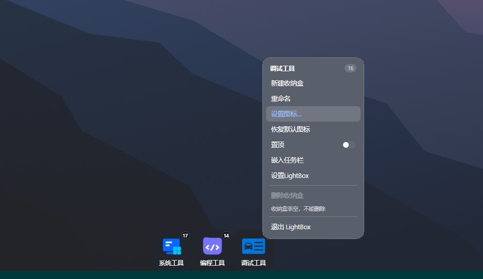
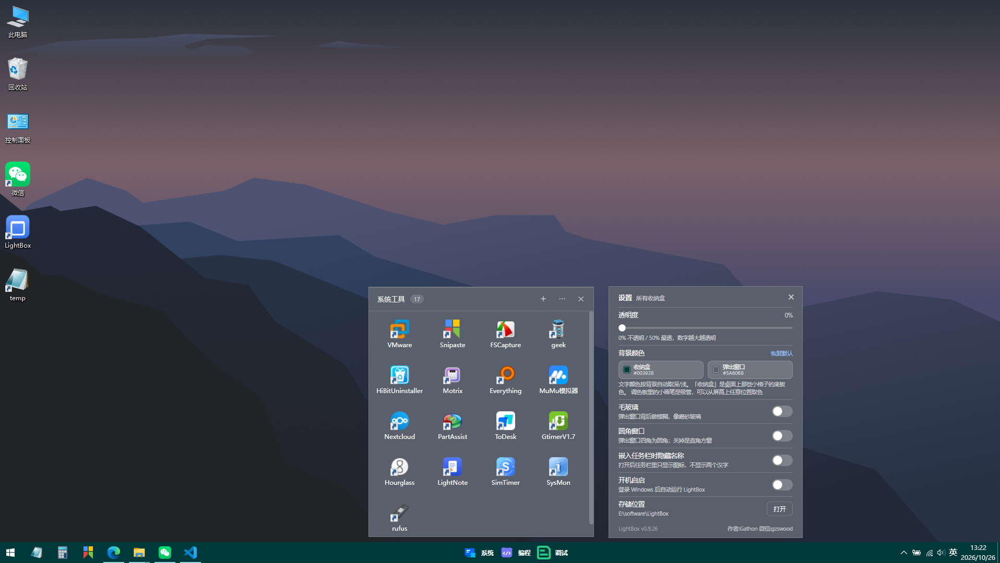
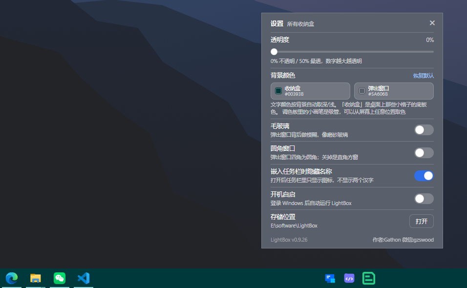

<div align="center">

# LightBox 桌面收纳盒

**把散在桌面上的快捷方式收进小方盒 —— Windows 轻量桌面整理工具**

单文件 exe，绿色免安装，约 3.9 MB。盒子可以贴在桌面层，也可以嵌入任务栏。

[](https://gitee.com/gathon/lightbox/releases)
[](#系统要求)
[](./LICENSE)
[](https://tauri.app/)
[](https://www.rust-lang.org/)

[下载最新版](https://gitee.com/gathon/lightbox/releases) · [功能](#功能) · [使用](#使用) · [构建](#构建) · [常见问题](#常见问题) · [更新记录](docs/version_list.md) · [GitHub 镜像](https://github.com/gzswood/lightbox)

</div>

***

> **下载与自动更新都以 Gitee 为准。** 代码同时镜像在
> [GitHub](https://github.com/gzswood/lightbox)，但安装包只发布在 Gitee ——
> exe 里的检查更新地址是编译期写死的（`src-tauri/update-url.txt`），
> 存量的旧版本全部指向 Gitee，换地址会让它们永久检查不到更新。

***

> **完全免费**，没有广告、没有捆绑、没有常驻后台服务。程序不收集任何使用数据，
> 唯一一次联网是启动后静默查一次版本号（可在设置里看结果，不影响使用）。

> **绿色版**：不写系统目录，不装服务，只有可选的「开机自启」会加一条注册表启动项。
> 配置文件和收纳的快捷方式都在程序 exe 文件根目录，boxes文件夹保存的是拖进去的快捷方式。

## 简介

LightBox 解决一个很小但很麻烦的问题：桌面图标越堆越多，查找程序得瞄好几眼。

它给你几个 **小方盒**，把图标归类摆放，桌面立刻清爽。点一下盒子弹出面板
（再点一次收起），里面的图标按你排的顺序铺开，单击直接启动。盒子本身可以贴在桌面层（不进 Alt+Tab、
按 `Win+D` 回桌面能看到它），也可以**拖进任务栏变成一个小胶囊**，随时一点即用。

程序是**单文件绿色版**：整个 lightbox.exe 约 3.9 MB，双击即用，不需要安装。配置（`config.json`）和
收纳的快捷方式（`boxes\` 目录）都放在 exe 旁边，把整个文件夹拷到别的机器上就能接着用。

目前主要适配 **Windows 10** 操作系统，Windows 11 还在努力调试中。

## 截图

|  |  |  |
| :---: | :---: | :---: |
| 收纳盒模式、右键菜单 | 任务栏胶囊模式、弹出面板 | 全局设置 |

## 功能

### 桌面收纳盒模式

- **拖进去就收纳** —— 从桌面把 `.lnk` / `.url` 快捷方式拖到盒子上，**移动**进 `boxes\{盒子id}\`，桌面立刻清爽
- **点开即用** —— 面板里单击启动程序；右键单个图标可「打开文件所在位置」「属性」「放回桌面」「从盒子移除」
- **面板内拖动排序** —— 安卓桌面那种：拖起来的那一格跟手浮起，被经过的格子依次让位，松手后顺序记进配置
- **框选与多选** —— 面板空白处按住拖出矩形即可框选；`Ctrl` + 单击加选/取消选，`Ctrl` + 框选追加，
  `Ctrl` + `A` 全选。选中后右键可对整批操作（打开全部 / 放回桌面 / 从盒子移除），也可以整批拖出面板
- **拖出到桌面** —— 按住图标拖出面板，走系统原生 OLE 拖拽，可以落到桌面或任意资源管理器窗口；
  多选后拖其中任意一个，**整批**一起出去
- **完全透明** —— 盒子没有底板，只有图标和名字，直接压在壁纸和桌面图标上；拖动时也实时透出。
  窗口只裁圆角，圆角以外的点击直接落到桌面（点得到下面的图标）
- **多盒子** —— 托盘菜单「新建收纳盒」，自动避开已有盒子、不出屏
- **首启两个空盒** —— 第一次运行时自动建「系统工具」「办公工具」，摆在任务栏上方居中，不挡任务栏
- **自动贴合** —— 盒子之间靠近时自动吸附，靠近屏幕边缘、任务栏边缘时也会贴边停靠；**绝不互相覆盖**

### 任务栏胶囊模式

- **嵌进任务栏** —— 右键「嵌入任务栏」；或者把盒子拖到任务栏上**覆盖过半、停住 0.3 秒**，
  不用松手就自动嵌入任务栏
- **排到队尾** —— 从菜单嵌入时，新胶囊自动排到现有胶囊的**最后**；队尾放不下就移到最前面。
  横向范围一律以托盘区左沿为界，**绝不遮住托盘图标、输入法和时钟**（拖过去的位置仍然听你的）
- **两个汉字或纯图标** —— 默认显示「系统」这样的两个字；设置里打开「嵌入任务栏时隐藏名称」后只剩正方形图标
- **自动贴合** —— 胶囊之间靠近时自动吸附，**绝不覆盖别的任务栏图标**；压到别人身上会挪到离自己最近的空位
- **移出任务栏**直接鼠标拖出到桌面，或者右键「移出任务栏」

### 胶囊团

几个盒子排在一起时可以触发胶囊团模式，此时**当成一个整体**用。

- **怎么组** —— 右键其中任意一个 →「组合为胶囊团」。菜单项只在**旁边有盒子挨着**的时候出现（单个孤立的盒子不显示）
- **组了之后** —— 拖动任意一个成员，整团一起跟手移动；拖到任务栏就是整排胶囊，拖回桌面就是整排盒子
- **嵌入任务栏** —— 团里任意成员右键「整团嵌入任务栏 / 整团移出任务栏」，整排一起移入或移出任务栏
- **解散** —— 右键任意成员 →「解散胶囊团」，立刻恢复成各自独立的盒子（位置、顺序都不变）

> 组合只是「记下了这几个盒子属于同一团」，不复制任何文件，也不影响盒子里面的图标。
> 团里的盒子仍然可以单独点开、单独收纳——整团只作用于**拖动**和**进出任务栏**。

### 外观

- **背景色自定义** —— 「收纳盒」和「弹出窗口」两个色块各自独立，内置取色器：
  20 个常用色 → 饱和/明度方块 → 色相条 → hex 输入 → **吸管**（可以在屏幕任意位置点取颜色）。
  注意：桌面上的盒子是**真透明**、没有底板，这个颜色只作用于**任务栏胶囊**和弹出面板
- **名字跟着壁纸走** —— 桌面盒子的名字不看背景色，而是看**盒子周围壁纸的亮度**：
  深色壁纸白字 + 深色阴影，浅色壁纸黑字 + 白色阴影（和 Windows 桌面图标同一套画法）。
  换壁纸、拖到明暗不同的区域后 1.5 秒内跟上，亮度卡在临界值时带滞回，不会来回闪
- **字色自动跟随** —— 弹出面板按背景色的 WCAG 相对亮度自动选深字还是白字，并推导出次要文字、分隔线、
  强调色。背景调成什么颜色都不会出现字和背景撞色
- **透明度 / 毛玻璃 / 圆角** 三个开关，改完立刻生效，没有「保存」按钮
- **自定义盒子图标** —— 右键「设置图标…」选一个 `.ico`，设过之后菜单多出「恢复默认图标」
- **跟随系统缩放** —— 100% / 125% / 150% 都按逻辑像素计算；双屏混合缩放下尺寸和位置也准

### 程序行为

- **系统托盘菜单** —— 新建收纳盒 / 自动排序 / 设置… / 退出
- **自动排序** —— 所有盒子复位到工作区底部居中一排，互不重叠、不被任务栏遮挡
- **盒子窗口自愈** —— 盒子挂在桌面进程下面，`explorer.exe` 重启会把它们一起销毁。
  自愈线程每 3 秒核对一遍，缺的按配置补建出来，顺手把同一个盒子多出来的重复窗口清掉
- **单实例** —— 重复双击不会叠出第二套盒子
- **开机自启** —— 写一条 `HKCU\Software\Microsoft\Windows\CurrentVersion\Run`，开关在设置里
- **更新提醒不弹窗** —— 程序启动时静默去 Gitee 仓库读一次 `version.json`；有新版本只在**设置页左下角的版本号**处显示红色提醒，
  你看到了再点。绝不主动开窗、不抢焦点
- **快捷方式正确启动** —— 先解析 `.lnk` 拿到「目标 + 参数 + 工作目录」再拉起程序，并滤掉
  `ELECTRON_*` / `NODE_OPTIONS` 这类会被子进程继承、导致 Electron 应用秒退的环境变量

## 系统要求

| 项 | 要求 |
| --- | --- |
| 系统 | Windows 10 64 位 |
| 运行时 | WebView2（近几年的 Win10 已自带；极老的 Win10 需装一次） |
| 权限 | 不需要管理员权限 |
| 磁盘 | 约 4 MB，加你自己的快捷方式 |

## 使用

1. 从 [Releases](https://gitee.com/gathon/lightbox/releases) 下载 `lightbox.exe`，放到一个**固定的文件夹**里
   （比如 `D:\LightBox`），双击运行。不要放在「下载」目录里，清理下载文件夹会把它一起删掉
2. 第一次运行，桌面会出现两个空盒子：「系统工具」「办公工具」
3. 从桌面把快捷方式拖到盒子上 —— 图标会消失，因为文件已经**移动**进盒子里了
4. 点一下盒子弹出面板，单击图标启动程序；再点一次这个盒子（或者按 `Esc`）收起面板
5. **右键盒子**可以：新建收纳盒 / 重命名 / 设置图标 / 恢复默认图标 / 置顶 / 嵌入任务栏 /
   组合为胶囊团 / 设置… / 删除收纳盒 / 退出
6. **托盘图标**右键：新建收纳盒 / 自动排序 / 设置… / 退出

> 删除盒子前会检查是否为空。盒子里还有东西时菜单项是灰的 —— 想把图标全倒回桌面，
> 用面板右上「⋯」里的**解散收纳盒**。

## 数据与备份

程序读写的文件都在 **exe 同一个目录**（exe 放在没有写权限的位置时，自动退回 `%LOCALAPPDATA%\LightBox`，
设置页的「存储位置」显示的就是实际在用的那个目录）：

| 文件 | 内容 | 要备份吗 |
| --- | --- | :---: |
| `config.json` | 盒子列表、位置、顺序、外观设置 | **要** |
| `boxes\{盒子id}\*.lnk` | 盒子里实际收纳的快捷方式文件 | **要** |
| `config.backup.json` | 每次启动时的配置快照，误操作后可以拿回来 | 可选 |
| `update.json` | 更新检查的时间戳，删掉等于重置 | 不用 |

**换机器或重装**：把 `config.json` 和 `boxes` 目录一起拷过去即可，盒子布局和里面的图标都在。
只拷 `config.json` 会得到一堆空盒子。

**升级版本**：下载新的 `lightbox.exe` 覆盖旧的就行，配置文件不会被改动。
建议先退出托盘里的 LightBox 再覆盖。

## 构建

要求：Windows 10/11 x64、**Node 18+**、**Rust 1.77+（MSVC 工具链）**、WebView2 运行时。

```bash
git clone https://gitee.com/gathon/lightbox.git          # 国内访问更快
# 镜像：git clone https://github.com/gzswood/lightbox.git
cd lightbox

npm install
npm run build:exe
```

产物：`src-tauri/target/release/lightbox.exe`（单文件，直接可用）。

开发模式（前端热更新）：

```bash
npm run app:dev
```

> ⚠️ 手工调 `cargo build` 时**必须带 `--features custom-protocol`**。tauri 判断「开发构建 / 正式构建」
> 看的是这个 feature，不是 cargo 的 debug/release —— 漏掉它，连 `--release` 出来的 exe 也会去
> 加载 `http://localhost:1420`，没有 vite 在跑时窗口里就是「localhost 拒绝连接」。
> `npm run build:exe` 已经帮你带上了。

发布流程（打 tag + 传安装包到 Gitee 发行版）见 [`tools/release-gitee.sh`](tools/release-gitee.sh)。

## 常见问题

<details>
<summary><b>桌面上的盒子突然全没了？</b></summary>

多半是 `explorer.exe` 重启过（装了软件、改了系统设置、或者资源管理器崩了）。
盒子是桌面进程的子窗口，父进程一死它们就跟着销毁。

v0.9.24 起有自愈线程，每 3 秒核对一次并自动补建，等几秒就回来了。
如果确实没了，托盘菜单「自动排序」也能重建。配置不会丢，`config.json` 里还记着。

</details>

<details>
<summary><b>怎么把任务栏里的胶囊弄回桌面？</b></summary>

三种办法：把胶囊**往上顶住 0.3 秒**（拖不出去是因为它被限制在任务栏那一条里，所以靠光标位置判断）；
右键菜单再点一次「嵌入任务栏」取消勾选；或者跑 `lightbox.exe --fix-bar` 一次全清。

</details>

<details>
<summary><b>右键菜单里没有「组合为胶囊团」？</b></summary>

这个菜单项只在**旁边有盒子挨着**的时候出现：两个盒子之间留着一大段空白时不算「挨着」，
把它拖到另一个盒子旁边（会自动吸附贴合），菜单里就有了。

组合是把盒子的 `group` 字段写成同一个值，不动任何文件；解散也只是把这个字段清掉，
盒子位置、顺序、里面收纳的图标都不受影响。

</details>

<details>
<summary><b>升级新版本会不会丢我的盒子配置？</b></summary>

不会。`config.json` 和 `boxes\` 目录跟程序是分开的，覆盖 exe 不影响它们。

只有一种例外：某些版本会调整**默认外观**（比如把底色改成 `#5A606B`、关掉圆角），
这类升级会按版本号迁移一次，把你自定义过的颜色和开关也重置成新默认值。迁移前程序会留一份
`config.before-v<版本号>.json`，想找回原来的配色就把它改名回 `config.json`。

</details>

<details>
<summary><b>杀毒软件报警 / 提示未知发布者？</b></summary>

exe 没有买代码签名证书（个人项目，证书一年几千块），所以 Windows 会显示「未知发布者」，
部分杀软对不认识的单文件 exe 也会先拦一下。加信任即可。

想彻底放心可以自己编译：源码全在仓库里，`npm run build:exe` 出来的就是同一个东西。

</details>

<details>
<summary><b>截图里桌面上的盒子变成一块白色？</b></summary>

桌面盒子用的是「跳过 DWM 重定向表面」的合成方式（`WS_EX_NOREDIRECTIONBITMAP`）——
只有这样才能既真透明、又不出现在窗口顶部那条写着 LightBox 的浅色横幅。

代价是它不再经过 DWM 的重定向表面：系统自带截图、QQ / 微信截图、任何**框选屏幕区域**的方式都正常，
极少数用 `PrintWindow` 直接抓窗口的工具可能抓到白块。遇到就换成框选截图。

</details>

<details>
<summary><b>点了图标没反应？</b></summary>

如果弹了「快捷方式指向的程序已不存在」，说明那个软件被卸载或换了位置 —— 把快捷方式删掉重新建一个。

如果什么提示都没有，检查一下：快捷方式本身在资源管理器里双击能不能打开。
LightBox 是解析 `.lnk` 拿到真实目标再启动的，比直接双击更严格。

</details>

<details>
<summary><b>支持多个显示器吗？两个屏缩放比例不一样呢？</b></summary>

支持。盒子的位置、尺寸、DPI 全都按所在显示器的实际缩放算，125% + 150% 混插也不会跑到错误的屏上、
不会偏到角落。换显示器或者改缩放之后，托盘「自动排序」能一次把盒子摆回合理位置。

</details>

<details>
<summary><b>会不会自己弹窗催我更新？</b></summary>

不会。检查更新全程静默，有新版本只在**设置窗口左下角的版本号**那里显示一行红色文字
（`● v0.9.26 → v0.9.27 可更新`），你自己决定点不点。托盘菜单里有「检查更新…」可以手动查。

</details>

<details>
<summary><b>为什么拖到任务栏要「停住一下」才嵌入？</b></summary>

防误触。覆盖过半就吸附的话，你只是把盒子拖到屏幕下方就会被吸进任务栏。
所以留了 0.3 秒的确认时间（最初是 0.5 秒，实测延迟感偏大，改成了 0.3 秒）。
同理，从任务栏往上顶也要顶住 0.3 秒才退回桌面。单个盒子和胶囊团用的是同一个时长。

</details>

## 技术栈

| 分类 | 选型 |
| --- | --- |
| 语言 | Rust（后端）+ TypeScript（前端） |
| 应用框架 | Tauri v2（单文件 exe，不打包 Node） |
| 前端 | React 18 + Vite 5 |
| Windows 集成 | 手写 Win32 FFI（`win32.rs`），显示器 / DPI / 窗口摆位 / 圆角裁剪全自己算 |
| 网络 | 手写 WinHTTP FFI（`http.rs`），**零第三方网络依赖**，自己处理 301 与 JS 反爬挑战 |
| 持久化 | `serde_json` → `config.json` |
| 图标提取 | `SHGetFileInfoW` + `HICON` → PNG data URL |
| 构建 | `vite build` + `cargo build --release --features custom-protocol` |

**为什么网络也自己写？** 只为了查一个 `version.json`，引 `reqwest` 会让体积翻几倍、编译时间多几分钟。
现在整个后端只依赖 tauri / serde / windows-sys，exe 保持 3.9 MB。

## 目录结构

```
src/                 前端（React）
  BoxView.tsx        盒子窗口页面
  PanelView.tsx      弹出面板（图标格子、框选多选、拖动排序）
  MenuView.tsx       右键菜单窗口
  SettingsDialog.tsx 设置弹层
  PickView.tsx       自绘取色器
  UpdateView.tsx     更新窗口
src-tauri/
  src/lib.rs         窗口生命周期、盒子/胶囊/面板逻辑、托盘
  src/desktop.rs     显示器枚举、DPI、窗口摆位、任务栏矩形
  src/win32.rs       Win32 API 声明（手写 FFI）
  src/store.rs       config.json 读写、默认值迁移
  src/updater.rs     版本检查（静默、不弹窗）
  src/http.rs        WinHTTP 封装 + 反爬挑战
  src/shortcut.rs    .lnk 解析与进程启动
  src/glass.rs       面板毛玻璃（自截自糊）
  src/pick.rs        取色器后端
  src/icons.rs       图标提取与缓存
update-site/         更新清单 version.json（程序直接读 Gitee raw，不用自建站点）
                     ⚠️ 目录名沿用旧称，路径已编译进 exe，不能改名或移动
tools/               Gitee 一键发版脚本
docs/                更新记录与截图
```

## 开源协议

Copyright (C) 2026 Gathon

本项目以 **[GNU AGPL-3.0](https://www.gnu.org/licenses/agpl-3.0.html)** 协议开源，协议全文见 [LICENSE](LICENSE)。

你可以自由使用、修改、分发，自己用或者公司内部用没有任何额外义务。AGPL-3.0 是强 copyleft 协议：
**基于本项目修改后的版本如果对外分发，必须以同样的协议公开源代码**；把它部署成网络服务供他人使用时，
也要提供对应源码。这条约束的目的是防止有人拿它做闭源的二次打包、或者包装成收费软件。

## 更多

- 仓库（主）：<https://gitee.com/gathon/lightbox>
- 代码镜像：<https://github.com/gzswood/lightbox>（只托管代码，不发布安装包）
- 版本下载：<https://gitee.com/gathon/lightbox/releases>
- 问题反馈：<https://gitee.com/gathon/lightbox/issues>
- 更新记录：[docs/version_list.md](docs/version_list.md)

<div align="center">


作者：Gathon

微信：gzswood

微信公众号：爱学习的xcoder
</div>

